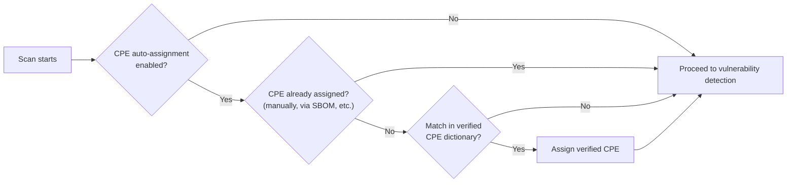

<a href="#cpepurl-assignment" class="md-skip">Skip to content</a>

 This page is machine-translated and may contain inaccuracies. If you have any questions, please [contact us via this form](https://futurevuls.zendesk.com/hc/ja/requests/new?ticket_form_id=18804395482009).

 

 FutureVuls Document 

 CPE/PURL Assignment 

  

- <a href="../../../../../manual/scan/cpe/assign_cpe_purl/" class="md-select__link" hreflang="ja">日本語</a>
- <a href="./" class="md-select__link" hreflang="en">English</a>

 

Initializing search

- <a href="../../../../" class="md-tabs__link">Home</a>
- <a href="../../../" class="md-tabs__link">Manual</a>
- <a href="../../" class="md-tabs__link">Scan</a>
- <a href="../../../../tutorial/" class="md-tabs__link">Tutorial</a>
- <a href="../../../../releasenotes/" class="md-tabs__link">Release Notes</a>
- <a href="../../../../glossary/" class="md-tabs__link">Glossary</a>
- <a href="../../../../inquiry/" class="md-tabs__link">Inquiry</a>

 FutureVuls Document

 Home  

 Home

- <a href="../../../../" class="md-nav__link"> About FutureVuls Document </a>
- <a href="../../../saas_requirements/" class="md-nav__link"> Service Connectivity Requirements </a>
- <a href="../../../clock_sync/" class="md-nav__link"> Clock Synchronization </a>
- <a href="../../../data_location/" class="md-nav__link"> Data Storage Location </a>

 Manual  

 Manual

<a href="../../../" class="md-nav__link"> Overview </a>

 Basic Operations & User Management  

 Basic Operations & User Management

- <a href="../../../basic_usage/" class="md-nav__link"> Basic Usage </a>
- <a href="../../../account/" class="md-nav__link"> Account Registration </a>
- <a href="../../../org_group/" class="md-nav__link"> Organization &amp; Group </a>
- <a href="../../../user_management/" class="md-nav__link"> User Management </a>
- <a href="../../../target/" class="md-nav__link"> Supported Environments </a>

 Basic Screens  

 Basic Screens

 Vulnerabilities  

 Vulnerabilities

- <a href="../../../cve/" class="md-nav__link"> CVE Tab </a>
- <a href="../../../cve_description/" class="md-nav__link"> CVE Details </a>
- <a href="../../../cve_filter/" class="md-nav__link"> Important CVE Conditions </a>
- <a href="../../../cert/" class="md-nav__link"> Security Alerts </a>
- <a href="../../../exploit/" class="md-nav__link"> Published Exploit Code </a>
- <a href="../../../topic/" class="md-nav__link"> Topics </a>

 Tasks  

 Tasks

- <a href="../../../task/" class="md-nav__link"> Tasks Tab </a>
- <a href="../../../task_description/" class="md-nav__link"> Task Details </a>
- <a href="../../../task_ignore/" class="md-nav__link"> Hide Task Settings </a>
- <a href="../../../detection_reliability/" class="md-nav__link"> Detection Reliability </a>
- <a href="../../../update_command/" class="md-nav__link"> Update Command </a>

 Supply Chain Risk  

 Supply Chain Risk

- <a href="../../../supply_chain_risk/" class="md-nav__link"> Overview </a>
- <a href="../../../supply_chain_risk_tab/" class="md-nav__link"> Supply Chain Risk Tab </a>
- <a href="../../../supply_chain_risk_description/" class="md-nav__link"> Supply Chain Risk Details </a>

 Servers・product  

 Servers・product

- <a href="../../../server/" class="md-nav__link"> Servers・product Tab </a>
- <a href="../../../server_description/" class="md-nav__link"> Server/Product Details </a>
- <a href="../../../scan_import/" class="md-nav__link"> Import External Scan Results </a>

<a href="../../../role/" class="md-nav__link"> Roles </a>

<a href="../../../software/" class="md-nav__link"> Software </a>

<a href="../../../advisory/" class="md-nav__link"> Advisory </a>

 Other Features  

 Other Features

 SBOM Management  

 SBOM Management

<a href="../../../sbom/" class="md-nav__link"> Overview </a>

<a href="../../../sbom/server_application/" class="md-nav__link"> Server SBOM &amp; Application SBOM </a>

 Import  

 Import

- <a href="../../../sbom/import/" class="md-nav__link"> Import SBOM File </a>
- <a href="../../../sbom/import_spec/" class="md-nav__link"> Import Specifications </a>
- <a href="../../../sbom/cyclonedx/" class="md-nav__link"> CycloneDX Import Specifications </a>
- <a href="../../../sbom/spdx/" class="md-nav__link"> SPDX Import Specifications </a>

<a href="../../../sbom/relation/" class="md-nav__link"> View Source SBOM Files </a>

<a href="../../../sbom/export/" class="md-nav__link"> Export SBOM </a>

<a href="../../../priority/" class="md-nav__link"> Vulnerability &amp; Task Priority </a>

 FutureVuls API  

 FutureVuls API

- <a href="../../../developer_api/" class="md-nav__link"> Developer API </a>
- <a href="../../../developer_api/sample/" class="md-nav__link"> API Samples </a>
- <a href="../../../developer_api/rate_limit/" class="md-nav__link"> Rate Limit </a>

 Settings  

 Settings

- <a href="../../../setting/user/" class="md-nav__link"> User Settings </a>
- <a href="../../../setting/group/" class="md-nav__link"> Group Settings </a>
- <a href="../../../setting/groupset/" class="md-nav__link"> Group Set Settings </a>
- <a href="../../../setting/org/" class="md-nav__link"> Organization Settings </a>

 Notifications  

 Notifications

- <a href="../../../notification/" class="md-nav__link"> Notification Features </a>
- <a href="../../../notification/slack_app/" class="md-nav__link"> Slack App </a>
- <a href="../../../notification/teams/" class="md-nav__link"> Teams </a>

 Integrations  

 Integrations

<a href="../../../integration/" class="md-nav__link"> Overview </a>

 AWS Integration  

 AWS Integration

- <a href="../../../integration/aws/" class="md-nav__link"> Overview </a>
- <a href="../../../integration/aws/auth/" class="md-nav__link"> Authentication Settings </a>
- <a href="../../../integration/aws/ssm_package_update/" class="md-nav__link"> SSM Package Update </a>
- <a href="../../../integration/aws/ssm_scan/" class="md-nav__link"> SSM Scan </a>
- <a href="../../inspector/" class="md-nav__link"> Inspector Integration </a>
- <a href="../../../integration/aws/tag/" class="md-nav__link"> AWS EC2 Tag Integration </a>

<a href="../../../integration/gcp/" class="md-nav__link"> GCP Integration </a>

<a href="../../../integration/slack/" class="md-nav__link"> Slack Integration </a>

<a href="../../../integration/ghsa/" class="md-nav__link"> GitHub Integration </a>

 SAML Integration  

 SAML Integration

- <a href="../../../integration/saml/" class="md-nav__link"> SSO Login </a>
- <a href="../../../integration/saml/okta/" class="md-nav__link"> Okta Integration </a>
- <a href="../../../integration/saml/onelogin/" class="md-nav__link"> OneLogin Integration </a>

 CloudOne Integration  

 CloudOne Integration

- <a href="../../../integration/cloudone/" class="md-nav__link"> CloudOne Integration </a>
- <a href="../../../integration/cloudone/old/" class="md-nav__link"> API Key Retrieval (Legacy Account System) </a>

<a href="../../../integration/mcp/" class="md-nav__link"> MCP Server Integration </a>

 CSIRT Plan  

 CSIRT Plan

- <a href="../../../csirt_option/" class="md-nav__link"> Overview </a>
- <a href="../../../csirt_option/ssvc/" class="md-nav__link"> SSVC </a>
- <a href="../../../csirt_option/auto_triage/" class="md-nav__link"> Auto Triage </a>
- <a href="../../../csirt_option/groupset/" class="md-nav__link"> Group Set </a>
- <a href="../../../csirt_option/dashboard/" class="md-nav__link"> Dashboard </a>
- <a href="../../../csirt_option/audit_log/" class="md-nav__link"> Audit Log </a>

 Scan  

 Scan

<a href="../../" class="md-nav__link"> About Scanning </a>

<a href="../../select/" class="md-nav__link"> How to Choose a Scan Method </a>

 Scan Methods  

 Scan Methods

 Local Scan  

 Local Scan

- <a href="../../local/" class="md-nav__link"> Local Scan </a>
- <a href="../../local/linux/" class="md-nav__link"> Local Linux Scans </a>
- <a href="../../local/windows/" class="md-nav__link"> Windows Local Scan </a>

<a href="../../remote/" class="md-nav__link"> Remote Scan </a>

 Paste Scan  

 Paste Scan

- <a href="../../paste/" class="md-nav__link"> Paste Scan </a>
- <a href="../../paste/linux/" class="md-nav__link"> Linux Paste Scan </a>
- <a href="../../paste/windows/" class="md-nav__link"> Windows Paste Scan </a>

<a href="../../trivy_scan/" class="md-nav__link"> Docker Scan (Trivy) </a>

<a href="../../image/" class="md-nav__link"> Docker Scan (ECR/GAR) </a>

<a href="../../application/" class="md-nav__link"> Application Scan </a>

 CPE Scan  

 CPE Scan

<a href="../" class="md-nav__link"> CPE Scan </a>

 CPE/PURL Assignment   <a href="./" class="md-nav__link md-nav__link--active"> CPE/PURL Assignment </a>

 Table of contents

- <a href="#distinguishing-between-cpe-and-purl" class="md-nav__link"> Distinguishing Between CPE and PURL </a>
- <a href="#manual-cpepurl-assignment" class="md-nav__link"> Manual CPE/PURL Assignment </a>
- <a href="#bulk-assignment-to-software" class="md-nav__link"> Bulk Assignment to Software </a>
- <a href="#automatic-cpe-assignment" class="md-nav__link"> Automatic CPE Assignment </a>

<a href="../network/" class="md-nav__link"> Network Device Scan </a>

<a href="../../inspector/" class="md-nav__link"> Inspector Integration </a>

<a href="../../wordpress/" class="md-nav__link"> WordPress Scan </a>

<a href="../../cicd_image/" class="md-nav__link"> CI/CD Pipeline Integration </a>

 About Scanner  

 About Scanner

<a href="../../auto_scan/" class="md-nav__link"> Scheduled Auto Scan </a>

<a href="../../requirements/" class="md-nav__link"> Scanner Requirements </a>

<a href="../../scanner_install/" class="md-nav__link"> Installation </a>

<a href="../../scanner_uninstall/" class="md-nav__link"> Uninstallation </a>

 Scan Settings  

 Scan Settings

- <a href="../../setting/" class="md-nav__link"> Configuration &amp; Notes </a>
- <a href="../../scanner_setting/" class="md-nav__link"> Scanner Operation Settings </a>
- <a href="../../proxy/" class="md-nav__link"> Proxy Settings </a>

<a href="../../scanner_stop/" class="md-nav__link"> Stop/Resume Scanner </a>

<a href="../../scanner_update/" class="md-nav__link"> Update Scanner </a>

 Tutorial  

 Tutorial

<a href="../../../../tutorial/" class="md-nav__link"> Overview </a>

<a href="../../../../tutorial/trial/" class="md-nav__link"> Try Free Trial </a>

<a href="../../../../tutorial/create_org/" class="md-nav__link"> Create Organization </a>

 Basic Operations  

 Basic Operations

- <a href="../../../../tutorial/first/flow/" class="md-nav__link"> Tutorial Flow </a>
- <a href="../../../../tutorial/first/create_group/" class="md-nav__link"> Create Group </a>
- <a href="../../../../tutorial/first/add_server/" class="md-nav__link"> Register Server </a>
- <a href="../../../../tutorial/first/servers/" class="md-nav__link"> Check Server Info </a>
- <a href="../../../../tutorial/first/cves/" class="md-nav__link"> Check Vulnerability Info </a>
- <a href="../../../../tutorial/first/task_management/" class="md-nav__link"> Check Task Info </a>
- <a href="../../../../tutorial/first/response/" class="md-nav__link"> Responding to Vulnerabilities </a>

 Useful Features  

 Useful Features

- <a href="../../../../tutorial/useful/groupset/" class="md-nav__link"> Group Set Feature </a>

 Operation Flow  

 Operation Flow

- <a href="../../../../tutorial/operation_flow/" class="md-nav__link"> Overview </a>
- <a href="../../../../tutorial/operation_flow/triage_setting/" class="md-nav__link"> CSIRT: Triage Settings </a>
- <a href="../../../../tutorial/operation_flow/manager/" class="md-nav__link"> CSIRT: Admin Perspective </a>
- <a href="../../../../tutorial/operation_flow/field_operator/" class="md-nav__link"> CSIRT: Operator Perspective </a>
- <a href="../../../../tutorial/operation_flow/standard/" class="md-nav__link"> Standard Plan Usage </a>

 Release Notes  

 Release Notes

<a href="../../../../releasenotes/" class="md-nav__link"> Past Releases </a>

 2026  

 2026

- <a href="../../../../releasenotes/20260910_hotfix/" class="md-nav__link"> 2026-09-10 [Hotfix] </a>
- <a href="../../../../releasenotes/20260717/" class="md-nav__link"> 2026-07-17 </a>
- <a href="../../../../releasenotes/20260600_hotfix/" class="md-nav__link"> 2026-06 [Hotfix] </a>
- <a href="../../../../releasenotes/20260603/" class="md-nav__link"> 2026-06-03 </a>
- <a href="../../../../releasenotes/20260600_pre/" class="md-nav__link"> 2026-06 [Advance Notice] </a>
- <a href="../../../../releasenotes/20260408_hotfix/" class="md-nav__link"> 2026-04-08 [Important] </a>
- <a href="../../../../releasenotes/20260406_hotfix/" class="md-nav__link"> 2026-04-06 [Important] </a>
- <a href="../../../../releasenotes/20260300_hotfix/" class="md-nav__link"> 2026-03 [Hotfix] </a>
- <a href="../../../../releasenotes/20260302_hotfix/" class="md-nav__link"> 2026-03-02 [Hotfix] </a>
- <a href="../../../../releasenotes/20260224/" class="md-nav__link"> 2026-02-24 </a>
- <a href="../../../../releasenotes/20260100_hotfix/" class="md-nav__link"> 2026-01 [Hotfix] </a>

 2025  

 2025

- <a href="../../../../releasenotes/20251222/" class="md-nav__link"> 2025-12-22 </a>
- <a href="../../../../releasenotes/20251200_hotfix/" class="md-nav__link"> 2025-12 [Hotfix] </a>
- <a href="../../../../releasenotes/20251100_hotfix/" class="md-nav__link"> 2025-11 [Hotfix] </a>
- <a href="../../../../releasenotes/20251111/" class="md-nav__link"> 2025-11-11 </a>
- <a href="../../../../releasenotes/20250900_hotfix/" class="md-nav__link"> 2025-09 [Hotfix] </a>
- <a href="../../../../releasenotes/20250714/" class="md-nav__link"> 2025-07-14 </a>
- <a href="../../../../releasenotes/20250500_hotfix/" class="md-nav__link"> 2025-05 [Hotfix] </a>
- <a href="../../../../releasenotes/20250421/" class="md-nav__link"> 2025-04-21 </a>
- <a href="../../../../releasenotes/20250205/" class="md-nav__link"> 2025-02-05 </a>

 2024  

 2024

- <a href="../../../../releasenotes/20241216/" class="md-nav__link"> 2024-12-16 </a>
- <a href="../../../../releasenotes/20241021/" class="md-nav__link"> 2024-10-21 </a>
- <a href="../../../../releasenotes/20240913/" class="md-nav__link"> 2024-09-13 </a>
- <a href="../../../../releasenotes/20240624/" class="md-nav__link"> 2024-06-24 </a>
- <a href="../../../../releasenotes/20240606/" class="md-nav__link"> 2024-06-06 </a>
- <a href="../../../../releasenotes/20240513/" class="md-nav__link"> 2024-05-13 </a>
- <a href="../../../../releasenotes/20240502/" class="md-nav__link"> 2024-05-02 </a>
- <a href="../../../../releasenotes/20240415/" class="md-nav__link"> 2024-04-15 </a>
- <a href="../../../../releasenotes/20240401/" class="md-nav__link"> 2024-04-01 </a>
- <a href="../../../../releasenotes/20240208/" class="md-nav__link"> 2024-02-08 </a>
- <a href="../../../../releasenotes/20240115/" class="md-nav__link"> 2024-01-15 </a>

 2023  

 2023

- <a href="../../../../releasenotes/20231120/" class="md-nav__link"> 2023-11-20 </a>
- <a href="../../../../releasenotes/20230926/" class="md-nav__link"> 2023-09-26 </a>
- <a href="../../../../releasenotes/20230911/" class="md-nav__link"> 2023-09-11 </a>
- <a href="../../../../releasenotes/20230725/" class="md-nav__link"> 2023-07-25 </a>
- <a href="../../../../releasenotes/20230530/" class="md-nav__link"> 2023-05-30 </a>
- <a href="../../../../releasenotes/20230426/" class="md-nav__link"> 2023-04-26 </a>
- <a href="../../../../releasenotes/20230329/" class="md-nav__link"> 2023-03-29 </a>
- <a href="../../../../releasenotes/20230301/" class="md-nav__link"> 2023-03-01 </a>
- <a href="../../../../releasenotes/20230206/" class="md-nav__link"> 2023-02-06 </a>

 2022  

 2022

- <a href="../../../../releasenotes/20221121/" class="md-nav__link"> 2022-11-21 </a>
- <a href="../../../../releasenotes/20220913/" class="md-nav__link"> 2022-09-13 </a>
- <a href="../../../../releasenotes/20220713/" class="md-nav__link"> 2022-07-13 </a>
- <a href="../../../../releasenotes/20220517/" class="md-nav__link"> 2022-05-17 </a>
- <a href="../../../../releasenotes/20220314/" class="md-nav__link"> 2022-03-14 </a>
- <a href="../../../../releasenotes/20220208/" class="md-nav__link"> 2022-02-08 </a>
- <a href="../../../../releasenotes/20220131/" class="md-nav__link"> 2022-01-31 </a>

 2021  

 2021

- <a href="../../../../releasenotes/20211209/" class="md-nav__link"> 2021-12-09 </a>
- <a href="../../../../releasenotes/20211029/" class="md-nav__link"> 2021-10-29 </a>
- <a href="../../../../releasenotes/20211015/" class="md-nav__link"> 2021-10-15 </a>
- <a href="../../../../releasenotes/20210730/" class="md-nav__link"> 2021-07-30 </a>
- <a href="../../../../releasenotes/20210618/" class="md-nav__link"> 2021-06-18 </a>
- <a href="../../../../releasenotes/20210521/" class="md-nav__link"> 2021-05-21 </a>
- <a href="../../../../releasenotes/20210416/" class="md-nav__link"> 2021-04-16 </a>
- <a href="../../../../releasenotes/20210408/" class="md-nav__link"> 2021-04-08 </a>
- <a href="../../../../releasenotes/20210128/" class="md-nav__link"> 2021-01-28 </a>

 Previous Years  

 Previous Years

- <a href="../../../../releasenotes/20201217/" class="md-nav__link"> 2020-12-17 </a>
- <a href="../../../../releasenotes/20201204/" class="md-nav__link"> 2020-12-04 </a>
- <a href="../../../../releasenotes/20201030/" class="md-nav__link"> 2020-10-30 </a>
- <a href="../../../../releasenotes/20200904/" class="md-nav__link"> 2020-09-04 </a>
- <a href="../../../../releasenotes/20200807/" class="md-nav__link"> 2020-08-07 </a>
- <a href="../../../../releasenotes/20200729/" class="md-nav__link"> 2020-07-29 </a>
- <a href="../../../../releasenotes/20200717/" class="md-nav__link"> 2020-07-17 </a>
- <a href="../../../../releasenotes/20200703/" class="md-nav__link"> 2020-07-03 </a>
- <a href="../../../../releasenotes/20200515/" class="md-nav__link"> 2020-05-15 </a>
- <a href="../../../../releasenotes/20200330/" class="md-nav__link"> 2020-03-30 </a>
- <a href="../../../../releasenotes/20191217/" class="md-nav__link"> 2019-12-17 </a>
- <a href="../../../../releasenotes/20191011/" class="md-nav__link"> 2019-10-11 </a>
- <a href="../../../../releasenotes/20190919/" class="md-nav__link"> 2019-09-19 </a>
- <a href="../../../../releasenotes/20190802/" class="md-nav__link"> 2019-08-02 </a>
- <a href="../../../../releasenotes/20190705/" class="md-nav__link"> 2019-07-05 </a>
- <a href="../../../../releasenotes/20190619/" class="md-nav__link"> 2019-06-19 </a>
- <a href="../../../../releasenotes/20190605/" class="md-nav__link"> 2019-06-05 </a>
- <a href="../../../../releasenotes/20190410/" class="md-nav__link"> 2019-04-10 </a>
- <a href="../../../../releasenotes/20190320/" class="md-nav__link"> 2019-03-20 </a>
- <a href="../../../../releasenotes/20190221/" class="md-nav__link"> 2019-02-21 </a>
- <a href="../../../../releasenotes/20190124/" class="md-nav__link"> 2019-01-24 </a>
- <a href="../../../../releasenotes/20190116/" class="md-nav__link"> 2019-01-16 </a>
- <a href="../../../../releasenotes/20181207/" class="md-nav__link"> 2018-12-07 </a>
- <a href="../../../../releasenotes/20181119/" class="md-nav__link"> 2018-11-19 </a>
- <a href="../../../../releasenotes/20181109/" class="md-nav__link"> 2018-11-09 </a>
- <a href="../../../../releasenotes/20181026/" class="md-nav__link"> 2018-10-26 </a>
- <a href="../../../../releasenotes/20181011/" class="md-nav__link"> 2018-10-11 </a>
- <a href="../../../../releasenotes/20181002/" class="md-nav__link"> 2018-10-02 </a>
- <a href="../../../../releasenotes/20180921/" class="md-nav__link"> 2018-09-21 </a>
- <a href="../../../../releasenotes/20180913/" class="md-nav__link"> 2018-09-13 </a>
- <a href="../../../../releasenotes/20180904/" class="md-nav__link"> 2018-09-04 </a>
- <a href="../../../../releasenotes/20180827/" class="md-nav__link"> 2018-08-27 </a>

 Glossary  

 Glossary

<a href="../../../../glossary/" class="md-nav__link"> Home </a>

 SSVC  

 SSVC

- <a href="../../../../glossary/cvss_problem/" class="md-nav__link"> CVSS Issues </a>
- <a href="../../../../glossary/ssvc/" class="md-nav__link"> What is SSVC </a>

<a href="../../../../glossary/epss/" class="md-nav__link"> EPSS </a>

 Inquiry  

 Inquiry

- <a href="../../../../inquiry/" class="md-nav__link"> Inquiry Tips </a>
- <a href="../../../../inquiry/zendesk_usecase/" class="md-nav__link"> How to Use Zendesk </a>
- <a href="../../../../inquiry/guidelines/" class="md-nav__link"> Terms &amp; Guidelines </a>
- <a href="https://futurevuls.zendesk.com/hc/ja/categories/24180989078169" class="md-nav__link"> FAQ </a>
- <a href="https://vuls.biz/contact/" class="md-nav__link"> Free Demo &amp; Consultation </a>
- <a href="../../../../inquiry/unsubscribe/" class="md-nav__link"> How to Unsubscribe </a>

# CPE/PURL Assignment<a href="#cpepurl-assignment" class="headerlink" title="Permanent link">#</a>

This page explains how to properly assign and manage the identifiers (CPE/PURL) that FutureVuls requires to detect vulnerabilities and EOL information.

In many cases, FutureVuls automatically detects vulnerabilities based on software version information during a scan. However, for CPE scans and supply chain risk scans, you must explicitly assign an identifier (CPE/PURL) to the software.

CPEs and PURLs are automatically assigned if they are included when a server is registered. If not, you can assign them manually, or for Windows applications, you can enable the auto-assignment setting to have them assigned during a scan.

To help you choose the appropriate method for your situation, this page will explain the following in order:

1.  **[Distinguishing Between CPE and PURL](#distinguishing-between-cpe-and-purl)** - First, check which identifier you should assign.
2.  **[Manual CPE/PURL Assignment](#manual-cpepurl-assignment)** - This is the method for manually assigning an identifier to individual software.
3.  **[Automatic CPE Assignment](#automatic-cpe-assignment)** - This is the method for enabling and managing the feature that automatically assigns CPEs to Windows applications.

## Distinguishing Between CPE and PURL<a href="#distinguishing-between-cpe-and-purl" class="headerlink" title="Permanent link">#</a>

<table>
<colgroup>
<col style="width: 33%" />
<col style="width: 33%" />
<col style="width: 33%" />
</colgroup>
<thead>
<tr class="header">
<th style="text-align: left;">Item</th>
<th style="text-align: left;">CPE (Common Platform Enumeration)</th>
<th style="text-align: left;">PURL (Package URL)</th>
</tr>
</thead>
<tbody>
<tr class="odd">
<td style="text-align: left;"><strong>Primary Purpose</strong></td>
<td style="text-align: left;"><strong>Vulnerability detection</strong> and some EOL detection</td>
<td style="text-align: left;"><strong>EOL detection</strong>, license detection, and vulnerability detection</td>
</tr>
<tr class="even">
<td style="text-align: left;"><strong>Primary Targets</strong></td>
<td style="text-align: left;">Middleware, commercial products, etc.</td>
<td style="text-align: left;">Mainly OSS libraries, frameworks, etc.</td>
</tr>
<tr class="odd">
<td style="text-align: left;"><strong>Identifier Example</strong></td>
<td style="text-align: left;"><code>cpe:/a:apache:http_server:2.4.54</code></td>
<td style="text-align: left;"><code>pkg:maven/org.apache.logging.log4j/log4j-core@2.17.1</code></td>
</tr>
<tr class="even">
<td style="text-align: left;"><strong>Auto-Assignment</strong></td>
<td style="text-align: left;">When CPE auto-assignment is enabled in <a href="../../../setting/group/#group">Group Settings</a>, CPEs are automatically assigned to Windows software during a scan (disabled by default). For details, see <a href="#automatic-cpe-assignment">Automatic CPE Assignment</a>.</td>
<td style="text-align: left;">・Libraries detected by <a href="../../application/">Application Scan</a> / <a href="../../../sbom/import_spec/">SBOM Import</a> 
・Dependent libraries in AWS environments detected by Amazon Inspector (*Requires configuration of <a href="../../inspector/#importing-amazon-inspector-sboms">Importing Amazon Inspector SBOMs</a>) 
・Software registered via <a href="../../../integration/ghsa/">GitHub Security Alerts Integration</a></td>
</tr>
<tr class="odd">
<td style="text-align: left;"><strong>Cases Requiring 
Manual Assignment</strong></td>
<td style="text-align: left;">・Middleware built from source 
・Software installed via an installer (*Some Windows applications can be handled by <a href="#automatic-cpe-assignment">CPE Auto-Assignment</a>) 
・Network devices, IoT devices</td>
<td style="text-align: left;">・Libraries not automatically detected by scans</td>
</tr>
<tr class="even">
<td style="text-align: left;"><strong>Detectable 
Information</strong></td>
<td style="text-align: left;"><strong>Vulnerabilities</strong>: Linked to vulnerability databases like NVD 
<strong>EOL</strong>: Products listed on <a href="https://github.com/vuls-saas/endoflife.date">vuls-saas/endoflife.date</a></td>
<td style="text-align: left;"><strong>EOL</strong>: Detected by <a href="https://github.com/vuls-saas/endoflife.date">vuls-saas/endoflife.date</a> and FutureVuls' proprietary logic (effective EOL) 
<strong>Vulnerabilities</strong>: Vulnerability information linked to PURLs, such as GHSA</td>
</tr>
</tbody>
</table>

### Recommended Usage<a href="#recommended-usage" class="headerlink" title="Permanent link">#</a>

- If your main goal is **vulnerability detection**, please assign a **CPE** ([Manual Assignment](#manual-cpepurl-assignment) or [Auto-Assignment](#automatic-cpe-assignment)).
- While **PURLs** are automatically assigned to most OSS libraries, manually registering them in the rare case they are not assigned will enable supply chain risk detection.

About Assigning CPE/PURL to OS Packages (Software Type: os)

Even if you assign a CPE or PURL to an OS package (software managed by package managers like rpm, deb, apk, etc.), it **will not be used for vulnerability detection**.

Vulnerability detection for OS packages is performed using OVAL or Security Trackers provided by Linux distributors, and OS-specific advisories (like Red Hat VEX). These vulnerability databases contain accurate version information that accounts for backporting and are more precise than NVD detection based on CPEs.

If you assign a CPE, the version ranges in NVD do not account for backporting, which will **frequently cause false positives**. For details, please see "[Registering CPEs for OS Packages](../../local/linux/#registering-cpes-for-os-packages)".

Therefore, assigning CPE/PURL to OS packages has no practical benefit and is not recommended. For OS package vulnerability management, please use scanner-based scans (local scan, remote scan, paste scan, etc.).

### Behavior When Both CPE and PURL Are Assigned<a href="#behavior-when-both-cpe-and-purl-are-assigned" class="headerlink" title="Permanent link">#</a>

You can assign both a CPE and a PURL to a single piece of software. The order of assignment does not affect the behavior.

The vulnerability detection behavior when both are assigned depends on the software type.

| Detection Target                 |                                   CPE only                                    |                     PURL only                     |            Both CPE + PURL             |
|:---------------------------------|:-----------------------------------------------------------------------------:|:-------------------------------------------------:|:--------------------------------------:|
| **Vulnerabilities** (NVD, etc.)  |                                       ✓                                       |                        ー                         |                ✓ (\*1)                 |
| **Vulnerabilities** (GHSA, etc.) |                                      ー                                       |                         ✓                         |                ✓ (\*1)                 |
| **EOL**                          | ✓ (Products on [endoflife.date](https://github.com/vuls-saas/endoflife.date)) | ✓ (endoflife.date + FutureVuls proprietary logic) | ✓ (Both detection methods are enabled) |
| **OSS Licenses**                 |                                      ー                                       |                         ✓                         |                   ✓                    |
| **Malicious Packages**           |                                      ー                                       |                         ✓                         |                   ✓                    |

Vulnerability Detection for Software Type 'library' (\*1)

For software of type **library**, vulnerability detection works as follows:

If vulnerabilities are detected from both the CPE and the PURL, the vulnerabilities detected via the PURL take precedence, and the vulnerabilities detected via the CPE are disabled. This is because GHSA vulnerability information is more accurate for libraries, and it prevents false positives caused by poorly maintained version range information in NVD.

Vulnerability Detection for Software Types Other Than 'library'

For software types **other than** library:

- **Detection based on NVD, etc. (CPE-based) will be enabled**
- **Detection based on GHSA, etc. (PURL-based) will not be performed**

For software other than libraries, such as middleware and commercial products, CPE-based NVD detection is the primary means of vulnerability detection.

EOL Detection Priority

EOL detection methods have a priority, applied in the order of **detected by endoflife.date \> detected by FutureVuls proprietary logic (effective EOL)**.

- Example: If endoflife.date detects "2025-06-30 EOL" and FutureVuls proprietary logic detects "2025-05-30 EOL", even though the FutureVuls logic date is earlier, the **endoflife.date of 2025-06-30** will take precedence.

If both a CPE and a PURL are assigned and different EOLs are detected via endoflife.date for both, the **earlier EOL date** will take precedence.

- Example: If an EOL of "2025-06-30" is detected via CPE from endoflife.date, and an EOL of "2025-12-31" is detected via PURL from endoflife.date, the earlier date of **2025-06-30** will be used.

When to Assign Both

- **When you want to add EOL, license, and malicious package detection to software (other than library) that already uses CPE for vulnerability detection**: Assign a PURL in addition. NVD vulnerability detection will remain active.
- **When you also assign a CPE to a library managed by PURL**: NVD vulnerability detection will not be performed, but EOL detection (via endoflife.date) will also be enabled on the CPE side. Assigning a CPE for the purpose of NVD-based vulnerability detection is unnecessary in this case.

------------------------------------------------------------------------

## Manual CPE/PURL Assignment<a href="#manual-cpepurl-assignment" class="headerlink" title="Permanent link">#</a>

### Assigning CPE/PURL to Software<a href="#assigning-cpepurl-to-software" class="headerlink" title="Permanent link">#</a>

From the Software tab, click on the target software. You can assign a CPE or PURL from "Assign CPE/PURL" on the details screen.

You can choose from the following three methods to register a CPE.

1.  CPE Auto Assignment

    Automatically assigns a CPE to the software based on a verified dictionary.

2.  Assign with Vendor/Product

    Specify the vendor and product names, and the version will be automatically completed. You can choose from the following methods for specification.

    | Method          | Description                                                     |
    |:----------------|:----------------------------------------------------------------|
    | Recommended CPE | Select a CPE with high relevance to the software name           |
    | Search CPE      | Search for CPE candidates and select the version, edition, etc. |
    | Enter Directly  | Enter the CPE directly                                          |

For Japan-specific software, you can also use JVN as the vulnerability database ([Details](../#scanning-japanese-domestic-software-using-jvn)).

About the Recommendation Feature's Learning Function

The CPE information you assign to software is used to train and improve the accuracy of recommendations. Rest assured that measures are in place to prevent user identification. [Terms of Service](https://github.com/vuls-saas/legaldocs/blob/master/contract.txt#L174)

To register a PURL, enter the PURL string (e.g., `pkg:maven/org.apache.logging.log4j/log4j-core@2.17.1`) into the text box. There are no recommendation or search functions like there are for CPEs. For the PURL format, please refer to the [PURL spec](https://github.com/package-url/purl-spec).

## Bulk Assignment to Software<a href="#bulk-assignment-to-software" class="headerlink" title="Permanent link">#</a>

On the Software tab, you can select multiple pieces of software to which you want to assign a CPE and assign them in bulk from the "Assign CPE" button.

For bulk assignment, you can only select vendor and product names from the recommended candidates. Select the vendor and product to assign from the dropdown menu.

Additionally, a link to the NVD search page is displayed under each vendor/product. By clicking the link, you can check if the corresponding CPE exists in NVD. Use this to help decide whether to collect JVN vulnerability information.

### Deleting Assigned CPE/PURL<a href="#deleting-assigned-cpepurl" class="headerlink" title="Permanent link">#</a>

If you want to delete an assigned CPE/PURL, click on the target software in the Software tab and press the delete icon. When an assignment is deleted, all vulnerability information and task information that was detected using that identifier will be deleted. However, if that vulnerability or task is also linked to other software on the same server, it will not be deleted.

------------------------------------------------------------------------

## Automatic CPE Assignment<a href="#automatic-cpe-assignment" class="headerlink" title="Permanent link">#</a>

In Windows environments, it is crucial not only to manage the OS's own updates but also to address vulnerabilities in installed third-party products (like Google Chrome, Adobe Acrobat Reader, etc.). However, manually looking up and assigning CPEs for each of these applications is time-consuming and labor-intensive.

The "CPE Auto Assignment" feature uses FutureVuls' proprietary verified CPE dictionary to match with Windows software detected during a scan and automatically assigns the appropriate CPE. This allows you to detect vulnerabilities in Windows third-party products without the tedious manual registration process.

The following sections describe each step in the usage flow and explain how to disable the feature.

### 1. Enable Automatic CPE Assignment (Group Settings)<a href="#1-enable-automatic-cpe-assignment-group-settings" class="headerlink" title="Permanent link">#</a>

To use this feature, enable "CPE Auto Assignment" in the [Group Settings](../../../setting/group/#group).

- The default setting for newly created groups is **Enabled**.
- The default setting for groups created before the February 2026 release is **Disabled**.

### 2. CPE Auto-Assignment via Scanning<a href="#2-cpe-auto-assignment-via-scanning" class="headerlink" title="Permanent link">#</a>

After enabling, CPEs will be automatically assigned during scans based on the verified CPE dictionary.

- This applies only to Windows software.
- Software to which a CPE has been manually assigned is not eligible for auto-assignment (manual assignments always take precedence).

### 3. Checking CPE Assignment Status (Software List)<a href="#3-checking-cpe-assignment-status-software-list" class="headerlink" title="Permanent link">#</a>

On the Software List screen, you can check the CPE assignment status in the "CPE Assignment Type" column, which is categorized into the following five types.

| CPE Assignment Type       | Description                                                                                                                                                                                            |
|---------------------------|--------------------------------------------------------------------------------------------------------------------------------------------------------------------------------------------------------|
| **Auto**                  | CPE automatically assigned based on the verified CPE dictionary.                                                                                                                                       |
| **Manual (Verified)**     | Manually assigned CPE matches the recommended CPE from the verified CPE dictionary.                                                                                                                    |
| **Manual (Mismatch)**     | Manually assigned CPE differs from the recommended CPE in the verified CPE dictionary. A warning icon is displayed on the software details screen, and the recommended CPE can be viewed in a tooltip. |
| **Manual (Not Verified)** | There is no corresponding entry in the verified CPE dictionary for the manually assigned CPE.                                                                                                          |
| **Not assigned**          | No CPE has been assigned.                                                                                                                                                                              |

Filtering by CPE Assignment Type is also supported. For information on screen display and filter operations, please see [Software List](../../../software/#software-list).

### 4. Disabling Automatic CPE Assignment for Specific Software<a href="#4-disabling-automatic-cpe-assignment-for-specific-software" class="headerlink" title="Permanent link">#</a>

If you want to exclude specific software from automatic CPE assignment, you can disable it individually. This is useful, for example, when an automatically assigned CPE's version is ANY, which creates a large number of tasks.

- You can disable it from the [Software Details](../../../software/#software-information) screen, or in bulk by selecting multiple items from the Software List.
- When disabled, the automatically assigned CPE is removed, and the software will be excluded from auto-assignment in subsequent scans.
- With the removal of the CPE, related vulnerability information and tasks are also deleted (this behavior is the same as [Deleting Assigned CPE/PURL](#deleting-assigned-cpepurl)). However, if that vulnerability or task is also linked to other software on the same server, it will not be deleted.

### 5. Disabling the Automatic CPE Assignment Feature (Group Settings)<a href="#5-disabling-the-automatic-cpe-assignment-feature-group-settings" class="headerlink" title="Permanent link">#</a>

If you wish to disable Automatic CPE Assignment, you can turn it off from the [Group Settings](../../../setting/group/#group).

- When disabled, no new automatic assignments will occur in subsequent scans.
- Even when disabled, previously auto-assigned CPEs are kept by default.
- You can select the "Bulk delete CPEs that were automatically assigned" option to delete all auto-assigned CPEs at once.
- Performing a bulk deletion will also delete the vulnerability information and tasks associated with the deleted CPEs. However, if that vulnerability or task is also linked to other software on the same server, it will not be deleted.

 Previous  CPE Scan

 Next  Network Device Scan

 Branch: **master** \| Commit: **249ea27** \| Deploy: **2026-09-29 13:03 JST** 

